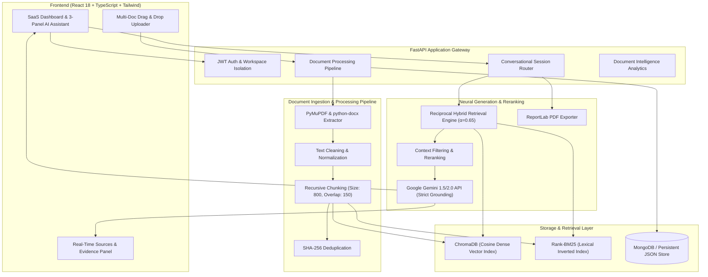

# Multi-Document RAG Intelligence Assistant

A production-grade, enterprise-ready Retrieval-Augmented Generation (RAG) platform designed to ingest multi-format enterprise documents (PDF, DOCX, TXT, Markdown), index them with hybrid dense-vector and BM25 lexical search, and synthesize accurate, grounded answers accompanied by page-level source citations and PDF executive reports.

---

## 1. System Architecture



---

## 2. Technology Stack

### Frontend
- **Framework:** React 18, TypeScript, Vite
- **Styling:** Tailwind CSS, PostCSS, Autoprefixer
- **UI Components & Icons:** Lucide React icons, custom SaaS components
- **Visual Analytics:** Recharts for chunk density and query activity timelines
- **Layout:** Linear/Perplexity-inspired 3-column AI Assistant layout (Scopes, Conversation, Evidence Panel)

### Backend
- **Framework:** Python 3.11, FastAPI, Uvicorn
- **Validation:** Pydantic v2, Pydantic-Settings
- **Security:** Passlib (Bcrypt), PyJWT (HS256 tokens)
- **File Parsing:** PyMuPDF (`fitz`), `python-docx`, native Markdown/TXT parsers
- **Vector Storage:** ChromaDB with persistent HNSW index
- **Keyword Search:** Rank-BM25 lexical engine
- **Generation:** Google Gemini API (`gemini-1.5-flash`, `gemini-2.0-flash`, `gemini-1.5-pro`)
- **PDF Reporting:** ReportLab engine for downloadable PDF executive briefs
- **Database:** MongoDB (`motor`) with automatic local JSON store fallback

---

## 3. Core RAG Pipeline Walkthrough

1. **Document Ingestion & SHA-256 Deduplication:**  
   Uploaded files are checked for duplicate SHA-256 checksums per workspace to prevent duplicate indexing and wasted tokens.
2. **Multi-Format Text Extraction:**  
   PyMuPDF extracts pages with exact page numbering preserved; `python-docx` parses headings, tables, and paragraphs.
3. **Recursive Structural Chunking:**  
   Text is split using recursive separators (`\n\n`, `\n`, `. `, ` `, `""`) preserving sentence boundaries with configurable token size (default: 800 tokens) and overlap (default: 150 tokens).
4. **Metadata Preservation:**  
   Every chunk carries immutable metadata: `document_id`, `filename`, `page_number`, `chunk_id`, and `workspace_id`.
5. **Dense Vector Embeddings:**  
   Embeddings are generated and persisted into ChromaDB cosine space.
6. **Lexical Keyword Indexing:**  
   A BM25 model is dynamically indexed for the workspace to catch specific codes, acronyms, and exact terminology.
7. **Reciprocal Hybrid Retrieval:**  
   Queries are evaluated using a weighted hybrid score:  
   $$\text{Score} = \alpha \cdot \text{Score}_{\text{vector}} + (1 - \alpha) \cdot \text{Score}_{\text{BM25}}$$  
   Where $\alpha$ (default 0.65) is dynamically tunable in the RAG Engine Settings.
8. **Strict Grounding & Answer Synthesis:**  
   Retrieved context is injected into the Gemini prompt with instructions requiring citation attribution (`[Doc: <filename>, Page: <page>]`) and refusal when facts are absent.
9. **Source Attribution & Citation Matching:**  
   Exact snippets are matched against retrieved chunks and rendered directly into the interactive Evidence Panel.

---

## 4. Project Directory Structure

```text
d:\Downloads\Rag project\
├── .env.example                  # Template configuration file
├── docker-compose.yml            # Multi-container orchestration (Backend, Frontend, MongoDB)
├── README.md                     # Documentation
│
├── backend/
│   ├── Dockerfile                # Production backend container build
│   ├── pytest.ini                # Pytest configuration
│   ├── requirements.txt          # Python dependencies
│   ├── app/
│   │   ├── main.py               # FastAPI entry point & CORS
│   │   ├── config.py             # Settings & environment variables
│   │   ├── database.py           # Hybrid MongoDB & Local JSON database manager
│   │   ├── auth/                 # JWT security, models, and endpoints
│   │   ├── documents/            # Extractors, chunkers, and upload routes
│   │   ├── chat/                 # Conversational sessions, PDF export, and chat router
│   │   ├── rag/                  # ChromaDB, BM25, embeddings, and Gemini synthesis
│   │   └── utils/                # PDF report generator, text cleaners
│   ├── tests/                    # E2E and unit test suite
│   ├── data/                     # Persistent ChromaDB and local store directory
│   └── uploads/                  # Temporary file upload directory
│
└── frontend/
    ├── Dockerfile                # Multi-stage Nginx production container
    ├── nginx.conf                # Nginx proxy configuration
    ├── package.json              # NPM dependencies
    ├── vite.config.ts            # Vite bundler and development proxy
    ├── index.html                # HTML entry point
    └── src/
        ├── main.tsx              # React entry point
        ├── App.tsx               # Main state container
        ├── index.css             # Tailwind base & dark mode styles
        ├── types/                # TypeScript interfaces & API contracts
        ├── api/                  # Unified client for backend REST APIs
        └── components/
            ├── Sidebar.tsx            # SaaS navigation & workspace switcher
            ├── DashboardOverview.tsx  # Overview, quick stats & recent items
            ├── ChatInterface.tsx      # 3-column AI conversational assistant
            ├── DocumentManager.tsx    # Upload, summarize, compare, question generator
            ├── AnalyticsDashboard.tsx # Recharts visualizations & usage metrics
            ├── SettingsView.tsx       # Live RAG pipeline tuning & API key config
            └── ActionModal.tsx        # Document summary, compare & questions modal
```

---

## 5. Getting Started

### Prerequisites
- Python 3.11+
- Node.js 18+ and npm
- (Optional) Docker and Docker Compose
- (Optional) Google Gemini API Key from [Google AI Studio](https://aistudio.google.com/)

---

### Method A: Local Development Setup

#### 1. Setup Backend
```powershell
cd "D:\Downloads\Rag project\backend"

# Create and activate virtual environment
python -m venv venv
.\venv\Scripts\Activate.ps1

# Install dependencies
pip install -r requirements.txt

# Start FastAPI development server
uvicorn app.main:app --reload --port 8000
```
* Backend API will run at: `http://localhost:8000`
* Swagger Interactive Docs: `http://localhost:8000/docs`

#### 2. Setup Frontend
```powershell
cd "D:\Downloads\Rag project\frontend"

# Install NPM dependencies
npm install

# Start Vite dev server
npm run dev
```
* Frontend Application will run at: `http://localhost:5173`

---

### Method B: Docker Compose Deployment

Run the entire stack (FastAPI, React + Nginx, MongoDB) with a single command:

```powershell
cd "D:\Downloads\Rag project"

# Copy environment template
copy .env.example .env

# Build and start all services
docker compose up --build -d
```
* **Frontend Web Application:** `http://localhost:3000`
* **FastAPI Backend:** `http://localhost:8000`
* **API Documentation:** `http://localhost:8000/docs`

---

## 6. Default Credentials

The platform comes pre-seeded with a ready-to-test architect account:
- **Email:** `demo@ragintelligence.ai`
- **Password:** `password123`

The frontend automatically logs into this demo account if no active token is detected in `localStorage`. You can also register custom accounts with isolated workspaces at any time.

---

## 7. REST API Endpoints

| Category | Method | Endpoint | Description |
|---|---|---|---|
| **Health** | `GET` | `/api/health` | Healthcheck & Gemini model status |
| **Auth** | `POST` | `/api/auth/register` | Register new user & default workspace |
| **Auth** | `POST` | `/api/auth/login` | Login with JWT access token |
| **Auth** | `GET` | `/api/auth/me` | Fetch active user profile |
| **Auth** | `GET` | `/api/auth/workspaces` | List all user workspaces |
| **Auth** | `POST` | `/api/auth/workspaces` | Create new isolated workspace |
| **Auth** | `POST` | `/api/auth/workspaces/{id}/switch` | Switch active workspace |
| **Documents** | `POST` | `/api/documents/upload` | Multipart upload (PDF, DOCX, TXT, MD) |
| **Documents** | `GET` | `/api/documents` | List documents in active workspace |
| **Documents** | `DELETE` | `/api/documents/{id}` | Delete document and its vector chunks |
| **Documents** | `POST` | `/api/documents/{id}/reindex` | Re-chunk and re-embed document |
| **Documents** | `POST` | `/api/documents/summary` | Generate executive document summary |
| **Documents** | `POST` | `/api/documents/compare` | Multi-document comparative analysis |
| **Documents** | `POST` | `/api/documents/generate-questions`| Generate study/interview questions |
| **Chat** | `POST` | `/api/chat` | Send prompt & receive RAG response |
| **Chat** | `GET` | `/api/chat/sessions` | List chat sessions for workspace |
| **Chat** | `POST` | `/api/chat/sessions` | Create new conversation session |
| **Chat** | `GET` | `/api/chat/sessions/{id}/messages` | Get message history for session |
| **Chat** | `DELETE` | `/api/chat/sessions/{id}` | Delete chat session |
| **Chat** | `POST` | `/api/chat/export-pdf` | Stream downloadable PDF report |
| **Search** | `POST` | `/api/search` | Direct hybrid/vector/BM25 retrieval |
| **Search** | `GET` | `/api/search/settings` | Get active RAG hyperparameters |
| **Search** | `POST` | `/api/search/settings` | Update RAG hyperparameters |
| **Analytics** | `GET` | `/api/analytics/dashboard` | Workspace document & query metrics |

---

## 8. Running Automated Tests

Run the test suite using `pytest`:

```powershell
cd "D:\Downloads\Rag project\backend"
.\venv\Scripts\pytest
```

The test suite covers:
- `tests/test_auth.py`: Password hashing (Bcrypt) and JWT token validation.
- `tests/test_rag_chunking.py`: PyMuPDF / text extractors and recursive chunker.
- `tests/test_hybrid_search.py`: Vector embeddings, BM25 indexing, and hybrid scoring.

---

## 9. Security & Production Best Practices

- **Zero API Key Leakage:** Frontend never has direct access to LLM API keys. Keys reside exclusively on the server or in secure environment variables.
- **Data Isolation:** Workspaces logically and physically isolate documents and ChromaDB collection names (`ws_<workspace_id>`).
- **File Validation:** Size limits (default: 50MB) and extension whitelisting prevent denial of service and execution attacks.
- **Fail-Safe Fallbacks:** The platform operates deterministically with local extractive synthesis and local storage if external services (MongoDB, Gemini) are temporarily unavailable.

